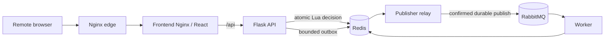

# RateLimit Studio

A browser-based educational studio for edge-based distributed rate limiting. It demonstrates Token Bucket and Sliding Window policies, shared Redis state, real traffic decisions, operational metrics, a RabbitMQ event pipeline, and controlled fault injection.

## Technology stack

- React and Vite dashboard, served by Nginx
- Flask API with Gunicorn
- Redis 7 for atomic Lua rate-limit decisions, persistent policy, history, metrics, and bounded outbox
- RabbitMQ 4 for durable event delivery
- Python worker and publisher/outbox relay
- Nginx reverse proxy; optional TLS edge profile
- Docker Compose for local and single-host deployment; Locust and Playwright for verification

## Architecture



The API decides synchronously against Redis. Events enter a bounded Redis outbox and are relayed to a durable RabbitMQ queue with publisher confirms and retry/recovery handling. The worker uses idempotency markers. Redis and RabbitMQ state persist in named Docker volumes. Only the Nginx edge publishes a host port; backend, frontend, Redis, RabbitMQ, publisher, and worker remain on private Compose networks.

## Local setup

Install Docker Engine and the Docker Compose v2 plugin. Copy `.env.example` to `.env`, replace the placeholder `ADMIN_TOKEN`, `RABBITMQ_USER`, and `RABBITMQ_PASSWORD` with unique local values, and keep `FAULTS_ENABLED=false` except for an isolated fault-injection test. For a local demo keep `HTTP_PORT=8080` and `FRONTEND_ORIGIN=http://localhost:8080`.

```sh
cp .env.example .env
# Edit .env locally; never commit it.
docker compose config --quiet
docker compose up --build -d
docker compose ps
```

Open [http://localhost:8080](http://localhost:8080). For browser-driven tests and benchmarks, see [docs/TESTING.md](docs/TESTING.md). Stop containers with `docker compose down`; this preserves named volumes. Do not use `docker compose down -v` when you need to keep Redis or RabbitMQ data.

## Docker Compose services

The default stack includes Redis, RabbitMQ, backend, worker, publisher, frontend, and Nginx. Redis and RabbitMQ have persistent named volumes and health checks. The publisher and backend also expose health status; Compose waits for healthy dependencies before starting the frontend. Optional `e2e`, `benchmarks`, and `tls` profiles add browser tests, Locust, and HTTPS edge service.

Check service health and logs:

```sh
docker compose ps
docker compose logs --tail=100 backend publisher worker nginx
```

## AWS EC2 deployment overview

The AWS deployment is a single EC2 academic demonstration, not a high-availability production architecture. Read [docs/AWS_DEPLOYMENT.md](docs/AWS_DEPLOYMENT.md) and [docs/KNOWN_LIMITATIONS.md](docs/KNOWN_LIMITATIONS.md) first. Deployment scripts are in `deployment/aws/`:

- `install-docker.sh` supports Ubuntu 22.04/24.04.
- `deploy.sh http` starts an HTTP demo; `deploy.sh tls` starts the TLS edge when a trusted certificate is installed.
- `update.sh` rebuilds/redeploys the selected mode.
- `healthcheck.sh` checks the public Nginx route.
- `rollback.sh <known-good-commit-or-tag> [http|tls]` deploys a Git revision using the existing named volumes.
- `backup.sh` briefly stops writers/brokers and archives Redis, RabbitMQ, and `.env`; backups contain secrets and require protected storage.

Do not expose ports 5000, 6379, 5672, or 15672. Restrict SSH to your public IP `/32`; allow 80 only for HTTP/ACME/redirect needs and 443 for HTTPS. AWS resources are not created by these scripts. Do not provision anything until the deployment plan and Learner Lab quota/costs are approved.

### Access from another laptop

After an operator has created and configured the EC2 instance and security group, start the application with host port 80 and browse to `http://<EC2_PUBLIC_IPV4>/`. Anyone with that address can reach the demo from an ordinary web browser; their laptop does not need Python, Node.js, Docker, Redis, or RabbitMQ. The EC2 instance and Compose services must remain running. A stop/start may change the public IPv4 unless a static address is configured, so the address may need to be shared again. HTTP is unencrypted and suitable only for a temporary non-sensitive demo. Trusted HTTPS needs a domain you control and a valid public certificate; a self-signed certificate is not trusted by browsers.

Policy changes, fault controls, benchmark runs, and metric resets require the shared admin token. The simulated traffic endpoints are intentionally available to browser users, so do not use this demo for sensitive data or unrestricted production workloads. Never share `.env` or the admin token with website visitors.

## Tests and benchmark

Backend and worker suites, Playwright flow, and repeatable Locust comparison instructions/results are described in [docs/TESTING.md](docs/TESTING.md). The browser dashboard uses measured backend metrics; charts do not rely on fabricated traffic samples.

## GitHub publishing

See [docs/GITHUB_PUBLISHING.md](docs/GITHUB_PUBLISHING.md) for the redacted security checklist and local GitHub publishing commands. The project does not push to GitHub automatically.
