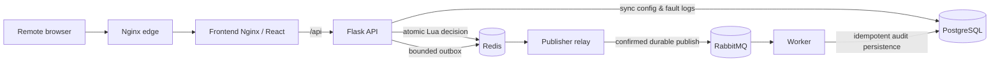

# RateLimit Studio

A browser-based educational studio for edge-based distributed rate limiting. It demonstrates Token Bucket and Sliding Window policies, shared Redis state, real traffic decisions, operational metrics, a RabbitMQ event pipeline, and controlled fault injection.

## Technology stack

- React and Vite dashboard, served by Nginx
- Flask API with Gunicorn
- PostgreSQL 16 for persistent relational request logging, configuration audit logs, fault histories, and system events
- Redis 7 for atomic Lua rate-limit decisions, session-isolated policies, real-time metrics, and transactional outbox
- RabbitMQ 4 for durable event delivery
- Python worker with PostgreSQL persistence and publisher/outbox relay
- Nginx reverse proxy; optional TLS edge profile
- Docker Compose for local and single-host deployment; Locust and Playwright for verification

## Architecture



The API decides synchronously against Redis in sub-milliseconds. Decisions enter a bounded Redis outbox and are relayed to a durable RabbitMQ queue with publisher confirms. The worker consumes events and idempotently writes structured request logs to PostgreSQL. Redis, RabbitMQ, and PostgreSQL state persist across restarts in named Docker volumes. Visitors receive isolated demo sessions automatically with no admin login required.

## Running RateLimit Studio Locally Without AWS

No EC2 instance, AWS credentials, hosted database, or AWS API is required. The browser uses same-origin `/api` calls through localhost Nginx. All service connections use Docker DNS names on an internal network. Once images are built, ordinary operation requires no internet. Google Fonts loading has been removed; system fonts work offline. Downloads are needed for Git clone, initial Docker images/npm/pip dependencies, and optional Playwright browser installation. Optional AWS deployment and trusted TLS certificate provisioning remain separate.

### Prerequisites and setup (Windows PowerShell 5.1 or newer)

Install Git and Docker Desktop using Linux containers with its WSL2 engine running. Allocate enough Docker memory for PostgreSQL, Redis, RabbitMQ and the app (4 GB is a reasonable starting point). Install Docker Compose v2 through Docker Desktop. Node/Python on the host are optional unless running host-side tests.

```powershell
git clone https://github.com/Anvi3011/RateLimit_Studio.git
Set-Location RateLimit_Studio
Copy-Item .env.example .env
```

Only copy the example on a new setup. Keep an existing `.env` and its credentials when using existing volumes. Generate a separate secret for each password and SESSION_SECRET with this PowerShell 5.1-compatible command, and paste each result into `.env` locally:

```powershell
$bytes = New-Object byte[] 32
$rng = [System.Security.Cryptography.RandomNumberGenerator]::Create()
$rng.GetBytes($bytes)
([BitConverter]::ToString($bytes)).Replace('-', '').ToLowerInvariant()
$rng.Dispose()
```

Set `SESSION_SECRET`, `POSTGRES_PASSWORD`, `RABBITMQ_USER` (for example `studio_local`), and `RABBITMQ_PASSWORD`. Use URL-safe letters/digits or generated hex credentials because Compose embeds them in connection URLs; reserved URL characters require percent-encoding in the connection URL. Never commit `.env`. Keep `HTTP_PORT=8080`, `FRONTEND_ORIGIN=http://localhost:8080`, `NUM_PROXIES=2`, and `RATE_LIMIT_FAIL_MODE=closed`. Leave `FAULTS_ENABLED=false` except during deliberate fault testing.

```powershell
docker compose config --quiet
docker compose up --build -d
docker compose ps
Invoke-RestMethod http://localhost:8080/api/health
```

Open [http://localhost:8080](http://localhost:8080). Health should show API, database, Redis, RabbitMQ, publisher and worker as healthy. All eight default services have health checks. Publisher/worker heartbeats and database connectivity are checked by the API. Compose waits on healthy dependencies; restart policies recover exited services (Docker does not automatically restart a running container just because it is unhealthy).

### Environment reference

| Variable | Use |
| --- | --- |
| SESSION_SECRET | Signs isolated demo session cookies; keep stable across restarts |
| POSTGRES_USER / POSTGRES_PASSWORD / POSTGRES_DB | Local PostgreSQL initialization and shared backend/worker connection credentials |
| RABBITMQ_USER / RABBITMQ_PASSWORD | Shared broker/publisher/worker/backend credentials |
| HTTP_PORT | Published Nginx port; default 8080 |
| FRONTEND_ORIGIN | Allowed browser origin; match HTTP_PORT |
| FAULTS_ENABLED | Enables controlled session fault injection; default false |
| RATE_LIMIT_FAIL_MODE | Redis failure behavior: closed or open |
| OUTBOX_CAPACITY | Maximum pending outbox records; default 5000 |
| LOG_RETENTION_HOURS | Session/log retention setting; default 24 |
| NUM_PROXIES | Trusted proxy hops; 2 for this Compose stack |
| TLS_CERT_DIR | Certificate directory for optional tls profile |

Compose assembles `DATABASE_URL`, `REDIS_URL` and `RABBITMQ_URL` internally. `API_PORT` and `WORKER_ID` are unused and are no longer advertised as configuration knobs.

### Database and messaging verification

Use the same browser session when comparing metrics and PostgreSQL logs. Request persistence is asynchronous; wait for the queue/outbox to drain. Configuration and fault audits are written synchronously. Existing tables are initialized with SQLAlchemy `create_all`; this is idempotent table creation, not a migration system for arbitrary older schemas.

```powershell
docker compose exec postgres sh -c 'psql -U "$POSTGRES_USER" -d "$POSTGRES_DB" -c "SELECT count(*) FROM request_logs;"'
docker compose exec redis redis-cli ping
docker compose exec rabbitmq rabbitmq-diagnostics -q ping
docker compose exec rabbitmq rabbitmqctl list_queues name messages_ready messages_unacknowledged consumers
docker compose logs --tail=100 backend publisher worker
```

The SQL count covers all sessions; the dashboard isolates your signed session cookie. Verify configuration history and fault history under Logs & Analytics, and use its CSV export (up to the latest 1,000 records per session). Redis AOF, PostgreSQL and RabbitMQ use persistent named volumes. Publishing uses confirms and bounded exponential retries; exhausted deliveries go to the Redis failed list, and worker processing failures go to a durable dead-letter queue. See [failed-event reconciliation](docs/FAILED_EVENT_RECONCILIATION.md); failures are retained for operator recovery rather than retried forever.

### Safe troubleshooting

If startup fails, inspect `docker compose ps` and service logs. A healthy `pg_isready` only proves the server is listening; API health additionally tests authentication and a database query. A broker ping likewise does not prove client credentials work.

Changing `.env` does **not** change passwords stored in initialized volumes. Prefer restoring the previous matching credentials from your protected local backup, then recreate the clients with `docker compose up -d`. Do not reset volumes.

For PostgreSQL, if the original local database role is known, connect interactively using that role:

```powershell
docker compose exec postgres sh -c 'psql -U "$POSTGRES_USER" -d "$POSTGRES_DB"'
```

If `.env` changed the username/database, substitute the original initialized role/database in that command. Inside psql use `\du` to inspect roles and `\password ratelimit_user` (substitute the actual role) to securely enter the password matching `.env`. Exit with `\q`, then run `docker compose up -d --force-recreate backend worker`. Take a protected database backup before schema or credential maintenance. Never automatically initialize a replacement database over the existing volume.

For RabbitMQ `ACCESS_REFUSED`, inspect `rabbitmqctl list_users` and `rabbitmqctl list_permissions -p /`. Restore matching `.env` values first. If rotating credentials, use an interactive shell and enter the existing user and new password without placing the password in shell history:

```powershell
docker compose exec rabbitmq sh
```

Inside the container:

```sh
read -r -p 'Existing RabbitMQ user: ' broker_user
read -r -s -p 'New password: ' broker_password; printf '\n'
rabbitmqctl change_password "$broker_user" "$broker_password"
unset broker_password
rabbitmqctl set_permissions -p / "$broker_user" '.*' '.*' '.*'
exit
```

The password is briefly visible in the container process arguments to privileged local observers. Prefer restoring the original credentials when possible. If the user does not exist, deliberately add it with `rabbitmqctl add_user` before granting permissions; do not delete existing users or queues. Update `.env` consistently, then run `docker compose up -d --force-recreate backend publisher worker`. Broker default-user environment variables only initialize a new broker database.

### Shutdown, restart and offline operation

```powershell
docker compose stop
docker compose start
# Or remove containers while preserving named data volumes:
docker compose down
docker compose up -d --no-build --pull never
```

Never use `docker compose down -v`, `docker volume prune`, or delete persistent data for troubleshooting. After an offline restart, verify `/api/health` and logs. Browser session retention and configured log cleanup still apply; volume persistence does not disable retention.

### Interactive controls

Sliders support mouse/touch, keyboard arrows/Home/End, visible focus, range indicators, units, and synchronized editable numbers. Invalid numeric drafts display an error and do not change the effective value; blur restores the last valid value. Ranges use integer steps of 1, except the derived sliding-window quota:

| Page | Controls and ranges |
| --- | --- |
| Overview | Custom count 1-500; existing Send 10 / Send 100 retained |
| Configuration | Token refill 1-100,000 tokens/s; sliding-window maximum W-100,000W requests in steps of W (W = window seconds); burst 1-100,000; window 1-3,600 seconds; logical edges 1-100 |
| Configuration and Traffic Inspector | Count 1-500, offered RPS 1-200; client identity and endpoint retained |
| Fault Injection | Duration 1-300 seconds; artificial latency 0-2,000 ms |

The existing sliding-window implementation uses rate times window seconds as its quota. Its slider displays that derived total and preserves the integer rate API without changing the algorithm. Configuration changes are staged until Apply. Fault slider changes affect the next activation; active faults retain their injected values. No unsupported concurrency or probability controls are sent. The API also supports fractional positive RPS, while the dashboard uses integer RPS. Traffic generation is synchronous and a slow batch can take minutes; the traffic endpoint has a 30-minute read timeout and Gunicorn has four threads so dashboard polling can continue. Ordinary requests retain the three-second proxy timeout for the network fault demonstration. Keep the page open until completion; refreshing does not cancel backend work. Artificial delay and request errors are reflected in real results; no synthetic decisions are fabricated.

## Docker Compose services

The default stack includes PostgreSQL, Redis, RabbitMQ, backend, worker, publisher, frontend, and Nginx. Redis and RabbitMQ have persistent named volumes and health checks. The publisher and backend also expose health status; Compose waits for healthy dependencies before starting the frontend. Optional `e2e`, `benchmarks`, and `tls` profiles add browser tests, Locust, and HTTPS edge service.

Check service health and logs:

```sh
docker compose ps
docker compose logs --tail=100 backend publisher worker nginx
```

## Optional AWS EC2 deployment overview

The AWS deployment is a single EC2 academic demonstration, not a high-availability production architecture. Read [docs/AWS_DEPLOYMENT.md](docs/AWS_DEPLOYMENT.md) and [docs/KNOWN_LIMITATIONS.md](docs/KNOWN_LIMITATIONS.md) first. Deployment scripts are in `deployment/aws/`:

- `install-docker.sh` supports Ubuntu 22.04/24.04.
- `deploy.sh http` starts an HTTP demo; `deploy.sh tls` starts the TLS edge when a trusted certificate is installed.
- `update.sh` rebuilds/redeploys the selected mode.
- `healthcheck.sh` checks the public Nginx route.
- `rollback.sh <known-good-commit-or-tag> [http|tls]` deploys a Git revision using the existing named volumes.
- `backup.sh` briefly stops writers/brokers and archives Redis, RabbitMQ, and `.env`; backups contain secrets and require protected storage.

Do not expose ports 5000, 6379, 5672, or 15672. Restrict SSH to your public IP `/32`; allow 80 only for HTTP/ACME/redirect needs and 443 for HTTPS. AWS resources are not created by these scripts. Do not provision anything until the deployment plan and Learner Lab quota/costs are approved.

### Access from another laptop

After an operator has created and configured the EC2 instance and security group, start the application with host port 80 and browse to `http://<EC2_PUBLIC_IPV4>/`. Anyone with that address can reach the demo from an ordinary web browser; their laptop does not need Python, Node.js, Docker, Redis, or RabbitMQ. The EC2 instance and Compose services must remain running. A stop/start may change the public IPv4 unless a static address is configured, so the address may need to be shared again. HTTP is unencrypted and suitable only for a temporary non-sensitive demo. Trusted HTTPS needs a domain you control and a valid public certificate; a self-signed certificate is not trusted by browsers.

Policy changes, fault controls, benchmark runs, and metric resets use isolated browser sessions without an admin token. Fault activation additionally requires FAULTS_ENABLED=true. Never share `.env` with visitors.

## Tests and benchmark

Backend and worker suites, Playwright flow, and repeatable Locust comparison instructions/results are described in [docs/TESTING.md](docs/TESTING.md). The browser dashboard uses measured backend metrics; charts do not rely on fabricated traffic samples.

## GitHub publishing

See [docs/GITHUB_PUBLISHING.md](docs/GITHUB_PUBLISHING.md) for the redacted security checklist and local GitHub publishing commands. The project does not push to GitHub automatically.
