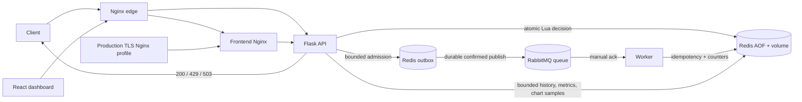

# Architecture

The rate decision is synchronous: Flask resolves client identity, chooses a collision-resistant client/endpoint/policy key, and executes one Redis Lua script. Token Bucket stores tokens and last-update time in a Redis hash. Sliding Window stores unique timestamped members in a sorted set. Both mutate state atomically. Backend processes share rate-limit state.

After the decision, API events are appended atomically to a bounded Redis list. A separate publisher moves each event to an inflight list, publishes a durable RabbitMQ message, and removes the inflight copy only after publisher confirmation. Failed sends are retried with capped backoff; exhausted events move to a 1,000-item failed list. On publisher restart, inflight events are requeued. A broker confirm can be lost after acceptance, so duplicates are possible; worker idempotency markers suppress repeated effects. The worker's marker-before-effect crash window remains.

Metrics include bounded history and a sorted-set of real request samples (10,000 samples / one hour). The time-series endpoint aggregates those samples into chart buckets. It does not synthesize traffic. Process CPU and memory are not measured.

Admin failures increment a 60-second Redis counter keyed by a hash of the trusted forwarded client address. Nginx independently rate limits sensitive routes. Fault controls are Redis keys with bounded TTLs; worker pause, API faults, and publisher instances observe shared state. Network-timeout injection delays a request beyond the private frontend proxy's three-second timeout. The service stack does not expose Redis, RabbitMQ, or Flask host ports.

Policy configuration remains the JSON value in `ratelimit:config`; no migration or flush is used. A small in-process copy is only used to choose fail-open/fail-closed behavior during Redis outage; it is not limiter state.
